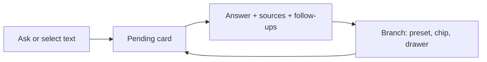
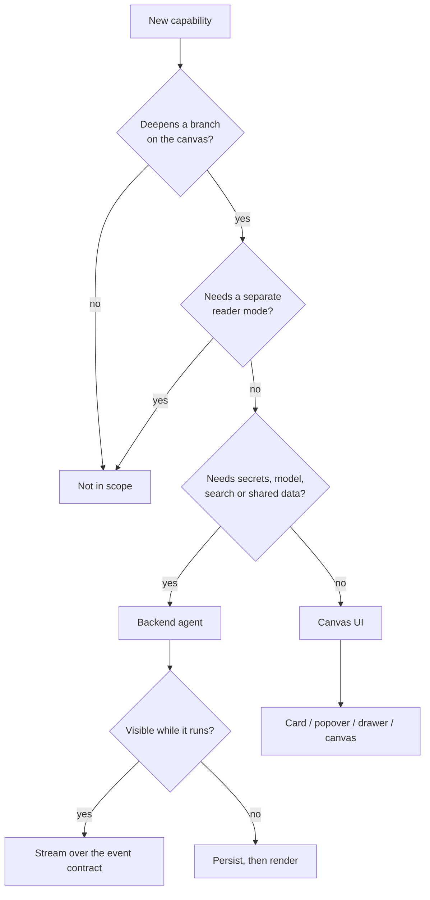

# DeepBurrow

Cloud-synced, BYOK, web-first rabbitholing. Deep dives branch; chat bubbles can't.

Reference UX: `~/Desktop/rabbithole` (vanilla JS + esbuild). We keep its feel and reimplement in React. This file states permanent product and architecture truths; current scope lives in `docs/mN.md`.

## Product

- One infinite canvas of cards. Cards branch from a question or a selected passage.
- Long answers scroll inside the card. No separate reader view.
- Cloud sync, editable system prompts, installable PWA.
- Web app only. No MCP, `.rabbithole` export, PNG/SVG, or share links.
- Agents and keys stay server-side. BYO search.
- Input is a plain-text question or a file; the composer does not parse Markdown or links.
- Answers may render GFM, tables, code, KaTeX and Mermaid. Raw HTML is inert.

## Flow

1. Sign in with email; connect an OpenAI-compatible provider (base URL, model, key). The backend verifies it.
2. Ask a question or attach a file.
3. The backend agent researches; tool calls never reach the browser.
4. The answer streams into a card with title, sources and follow-ups.
5. Branch from the answer or a selection. Context is the lineage root→node, never siblings.



## Canvas

- **Entry.** Empty burrow = one composer → root card.
- **Asking.** Select text → popover with input and preset pills (`1–3`). The child keeps the selected passage as its reference; the pending card sits beside its source.
- **Card.** Fixed head strip, scrollable body, sources, follow-up chips and a discreet follow-up button.
- **Notes.** One margin note per card, human or agent, fed to later prompts.
- **Presets.** Label + instruction, two sets (selection, follow-up), linkable.
- **⌘K.** Search titles, origin questions and answers; run canvas commands.
- **Canvas.** Drag; cards size to their content. Positions and the camera live on the server, so a reload lands where you left it.
- **Edit.** Rename inline; delete a branch and undo.
- **Export.** Download the rendered canvas as a standalone HTML document; text stays selectable and links work without the app. A small inline script adds theme, text-size, zoom, and image-lightbox controls; the page remains readable with JS off.
- **States.** `pending → answered | stopped | failed`. Failure keeps a reason and Retry; stopping keeps partial text.

## Answer contract

The header arrives before the body, so it can be parsed while streaming:

```
TITLE: TCP congestion control
SOURCES: Nagle — https://x | RFC 5681 — https://y
FOLLOWUPS: Why does slow start double per RTT? | When does CUBIC beat Reno?
```

Parse it, strip it, stream the rest untouched. Sources are what the model used, each checked against the search blob. Follow-ups are 2–3 questions.

Answers are stored as Markdown. Render with CommonMark/GFM (`react-markdown` + `remark-gfm`), KaTeX, Mermaid and `highlight.js`. Never enable raw HTML.

## Agent

LangGraph state machine. Nodes are pure `state → state`; model, search, DB and stream are adapters at the edge. Replaying a state gives the same result. Prompts are rebuilt each call; we persist completions only.

```
plan → search? → compose → judge → search? → summarize → END
```

- Only `summarize` writes user-visible text; everything before is notes.
- Stop when `judge` says done, or after 3 rounds. No token cap.
- Search is a pasted curl: one call per round, ~20k cap, labeled untrusted. Only URLs present verbatim in the blob may be cited.
- `ask` is the final text from the FE. Presets are applied client-side; the backend never knows which fired.

## Data

SQLite via `node:sqlite`, raw SQL, no ORM. Lineage is the node parent chain.

```
users(id, email, base_url, model, api_key_enc, search)
burrows(id, user_id, title)
nodes(id, burrow_id, parent_id, title, markdown, origin, sources, followups, status, error, canvas, deleted_at)
```

`origin` is UI provenance only; prompts come from `markdown` + lineage. Canvas state and soft-delete live on the node.

## Stack

- FE: React, Vite, Tailwind, shadcn/ui, `@xyflow/react`.
- BE: Hono on Node, LangGraph.js, `node:sqlite`, SSE.
- Shared `types` for state, nodes and events. Docker Compose; nginx serves the build and proxies `/api/`.

## Scope rule


