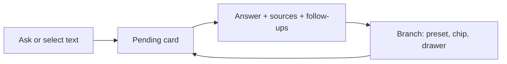
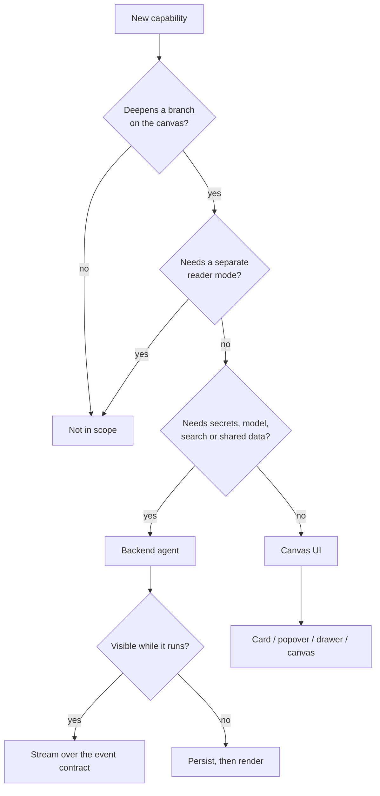

# DeepBurrow

Cloud-synced, BYOK, web-first rabbitholing. Deep dives branch; chat bubbles can't.

Reference UX: `~/Desktop/rabbithole` (vanilla JS + esbuild). We keep its feel and reimplement in React. This file states permanent product and architecture truths; current scope lives in `docs/mN.md`.

## Product

- Multiple user-owned burrows, each with an infinite canvas of cards. Cards branch from a question or a selected passage.
- Long answers scroll inside the card. No separate reader view.
- Cloud sync, editable system prompts, installable PWA.
- Web app only. No MCP, `.rabbithole` export, PNG/SVG, or share links.
- Agents and keys stay server-side. BYO search.
- Input is a plain-text question. File uploads are not supported yet.
- Answers may render GFM, tables, code, KaTeX and Mermaid. Raw HTML is inert.

## Flow

1. Sign in with your email and a six-digit code. No password is used.
2. Add an OpenAI-compatible model provider in Settings. If it is missing, a dismissible setup prompt appears; you can continue, but asks fail until a model key is configured. Search is optional and configured separately.
3. Ask a question.
4. The backend agent researches; tool calls never reach the browser.
5. The answer streams into a card with title, sources and follow-ups.
6. Branch from the answer or a selection. Context is the lineage root→node, never siblings.



## Canvas

- **Entry.** An empty canvas offers a new-burrow action; the modal takes a question or link and opens the canvas on the pending root card.
- **Burrows.** A collapsible sidebar lists the user's burrows; titles are unique per user.
- **Asking.** Select text → popover with input and preset pills (`1–3`). The child keeps the selected passage as its reference; the pending card sits beside its source.
- **Card.** Fixed head strip, the user's prompt as a Markdown quote, scrollable answer, sources, follow-up chips and a discreet follow-up button.
- **Presets.** Label + instruction, two sets (selection, follow-up), linkable.
- **⌘K.** Search titles, origin questions and answers; run canvas commands.
- **Canvas.** Drag; cards size to their content. Positions and the camera live on the server, so a reload lands where you left it.
- **Edit.** Rename inline; delete a branch and undo.
- **Export.** Download the rendered canvas as a standalone HTML document; text stays selectable and links work without the app. A small inline script adds theme, text-size, zoom, and image-lightbox controls; the page remains readable with JS off.
- **States.** `pending → answered | stopped | failed`. Failure keeps a reason and Retry; stopping keeps partial text.

Notes, reactions, and file uploads are deferred and have no scheduled milestone.

## Answer contract

The header arrives before the body, so it can be parsed while streaming:

```
TITLE: TCP congestion control
FOLLOWUPS: Why does slow start double per RTT? | When does CUBIC beat Reno?
```

Parse it, strip it, stream the rest untouched. Sources are not model output: the backend extracts every `https` URL from the raw search response, one entry per URL, titled by the URL. Follow-ups are 2–3 questions.

Answers are stored as Markdown. Render with CommonMark/GFM (`react-markdown` + `remark-gfm`), KaTeX, Mermaid and `highlight.js`. Never enable raw HTML.

## Agent

LangGraph state machine. Nodes are pure `state → state`; model, search, DB and stream are adapters at the edge. Replaying a state gives the same result. Prompts are rebuilt each call; we persist completions only.

```
generate ⇄ search → validate ⇄ repair → stream
```

- `generate` seeds the system prompt, root→node transcript and frontend message, then offers `web_search` as a native tool when search is configured. The model answers directly or calls it with one query or URL; up to three search rounds.
- `search` is one OpenAI-compatible call with its own endpoint, model and key. Its raw reply is evidence, never instructions, and returns as the tool result verbatim.
- After a search round, `generate` continues with the assistant tool call and its result in the conversation; the frontend message stays unchanged.
- `validate` runs the real KaTeX and Mermaid renderers plus link, header and fence checks before any token streams. At most two repairs; a usable body still answers, an empty one fails the node.
- One session id per run rides every LLM call (`session_id` and `x-session-id`); search is outside it. Limits: 30s per call, 5 min per search, 8 min per run.
- Provider errors surface verbatim; credentials never do. Keys are sealed with AES-GCM, endpoints are verified before save, and private addresses need an explicit dev opt-in.

## Data

SQLite via `node:sqlite`, raw SQL, no ORM. Lineage is the node parent chain.

```
users(id, email, model_base_url, model_name, model_api_key_enc, search_base_url, search_model, search_api_key_enc, theme, reading_size, presets_linked, selection_presets, followup_presets)
refresh_tokens(id, user_id, token_hash, created_at, expires_at)
push_subscriptions(endpoint, user_id, p256dh, auth, created_at)
burrows(id, user_id, title)
nodes(id, burrow_id, parent_id, title, markdown, origin, sources, followups, status, error, canvas, deleted_at)
```

Every private query is scoped to the authenticated user's ID. Burrows are owned by one user, and node access is authorized through that ownership chain. Login uses one-time email codes; provider keys are encrypted at rest.

`origin` is UI provenance only; prompts come from `markdown` + lineage. Canvas state and soft-delete live on the node.

## Stack

- FE: React, Vite, Tailwind, shadcn/ui, `@xyflow/react`.
- BE: Hono on Node, LangGraph.js, `node:sqlite`, SSE.
- Shared `types` for state, nodes and events. Docker Compose; nginx serves the build and proxies `/api/`.

## Auth configuration

- `AUTH_SECRET` — 32+ characters. Required when `NODE_ENV=production`.
- `SMTP_HOST`, `SMTP_PORT`, `SMTP_USERNAME`, `SMTP_PASSWORD`, `SMTP_FROM` — required by `make start` for six-digit email login codes.
- `make start` generates and preserves `AUTH_SECRET` when missing, then checks SMTP configuration before starting.
- `APP_ORIGIN` — comma-separated browser origins allowed to send state-changing requests; localhost is always allowed.
- `VAPID_PUBLIC_KEY`, `VAPID_PRIVATE_KEY`, `VAPID_SUBJECT` — Web Push credentials. `make start` generates missing keys and prompts for a `mailto:` or `https://` subject.
- Access lasts 15 minutes, refresh 30 days, and 10 failed attempts per IP/scope are allowed per 15 minutes. Production cookies are Secure.
- Tests seed the demo account and fixture burrow themselves; the API never creates a demo account.

## Scope rule


