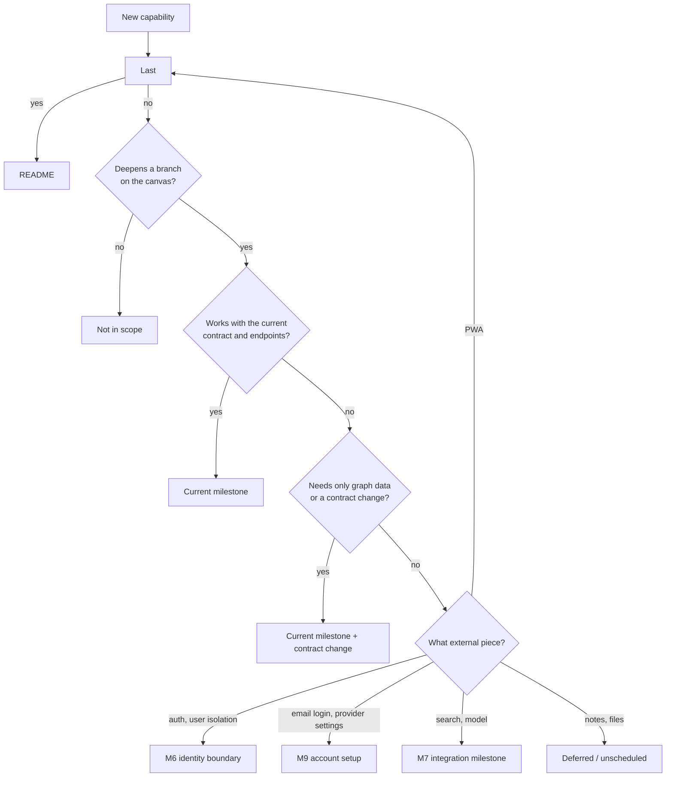
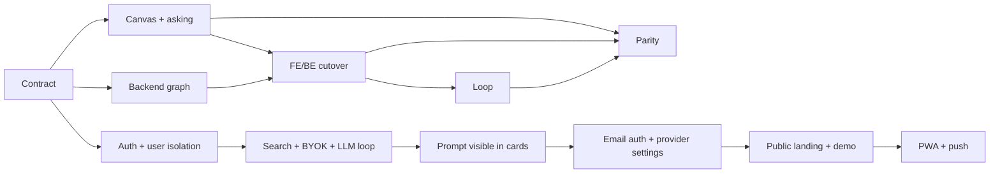

# Build plan

This file is the sequencing mental model, not today's scope. Per-milestone detail lives in `docs/mN.md`.

## One seam

Build the whole loop first: ask → answer card. Then split at the contract: FE against a mock SSE, BE against a fake model and search. The contract is shared types + DB schema + event list. Neither side blocks the other.

## Milestones

| # | Theme | Done when |
|---|---|---|
| M0 | Contract + scaffold | Shared types/schema/events; a fixture burrow renders |
| M1 | Canvas | Pan, zoom, long-body scroll, no overlap |
| M2 | Asking | Popover, drawer, pending/answered/stopped/failed against mock SSE |
| M3 | Backend cutover | Real BE + fake model; reload and retry work |
| M4 | Loop | Judge, rounds, progress lines; no stuck cards |
| M5 | Parity + durable graph | Reference flows match or every delta is logged; rename/delete/layout survive a fresh client |
| M6 | Auth + user isolation | User accounts, refreshable sessions, every query scoped to the signed-in user |
| M7 | Search + BYOK + LLM loop | Search filters sources; verified model key drives the real judge/search/compose loop |
| M8 | Burrows + visible prompts | Per-user unique burrow titles, collapsible sidebar, and prompt quotes in node cards; desktop/mobile E2E screenshots |
| M9 | Email auth + providers | Six-digit email login, provider/settings behavior, explicit user schema |
| M10 | Public landing + demo | Minimal public page and reproducible Playwright walkthrough video |
| M11 | PWA + push | Installable app, opt-in Web Push, completion notifications, VAPID setup |

## Where a feature goes

| Missing piece | Home |
|---|---|
| Nothing, or graph data / contract shape | Current milestone |
| Auth and user isolation | M6 |
| Email-code login and provider/settings refactor | M9 |
| Search, real model, BYOK | M7 integration |
| Notes, reactions, file uploads | Deferred / unscheduled |
| PWA | Last |
| A permanent product rule | README |
| Not a branch on the canvas | Never |

Renderers are the exception: build the renderer with the UI, then feed it real content when the model lands.

## Ordering

## Sizing

One slice = one exit test that fails before and passes after, roughly a day, one mock. If it needs two mocks, it is two slices.
