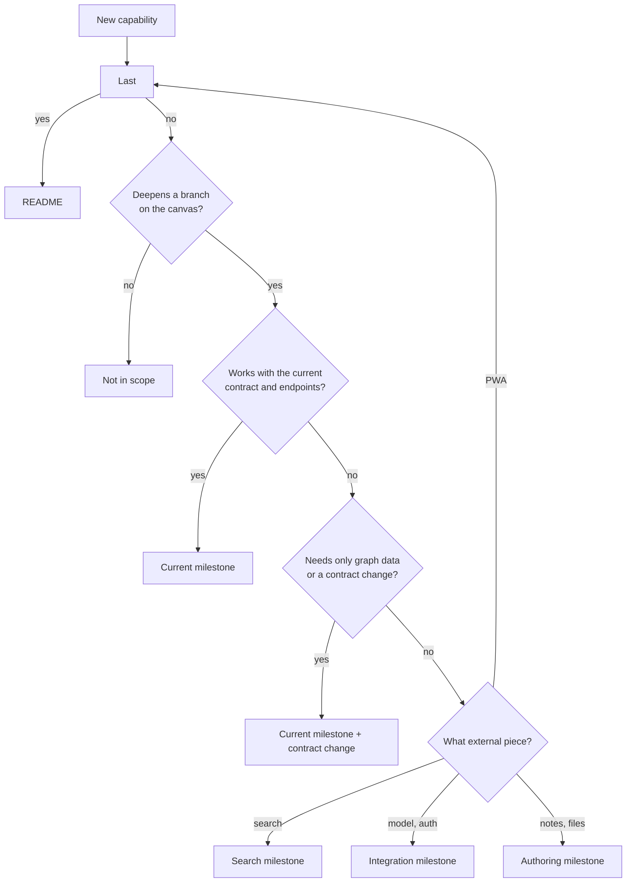
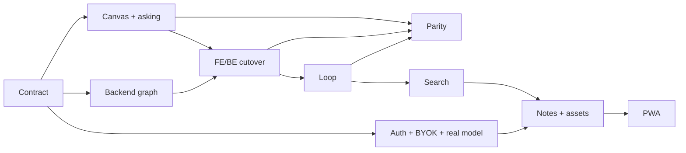

# Build plan

This file is the sequencing mental model, not today's scope. Per-milestone detail lives in `docs/mN.md`.

## One seam

Build the whole loop first: ask → answer card. Then split at the contract: FE against a mock SSE, BE against a fake model and search. The contract is shared types + DB schema + event list. Neither side blocks the other.

## Milestones

| # | Theme | Done when |
|---|---|---|
| M0 | Contract + scaffold | Shared types/schema/events; a fixture burrow renders |
| M1 | Canvas | Pan, zoom, long-body scroll, no overlap |
| M2 | Asking | Popover, drawer, pending/answered/stopped/failed against mock SSE |
| M3 | Backend cutover | Real BE + fake model; reload and retry work |
| M4 | Loop | Judge, rounds, progress lines; no stuck cards |
| M5 | Parity + durable graph | Reference flows match or every delta is logged; rename/delete/layout survive a fresh client |
| M6 | Search | Fixture search runs; sources are filtered and cited |
| M7 | Auth + BYOK + real model | Login, verified key, real GFM/KaTeX/Mermaid output |
| M8 | Notes + assets | Notes feed prompts; files/PDF/images/URLs become origins |
| M9 | PWA | Install + hidden-tab completion notification |

## Where a feature goes

| Missing piece | Home |
|---|---|
| Nothing, or graph data / contract shape | Current milestone |
| Search | Search milestone |
| Real model, auth | Integration |
| Notes, reactions, files | Authoring |
| PWA | Last |
| A permanent product rule | README |
| Not a branch on the canvas | Never |

Renderers are the exception: build the renderer with the UI, then feed it real content when the model lands.

## Ordering

## Sizing

One slice = one exit test that fails before and passes after, roughly a day, one mock. If it needs two mocks, it is two slices.
